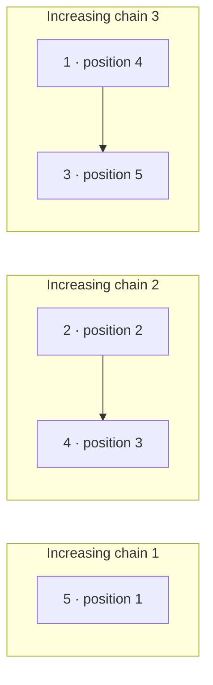
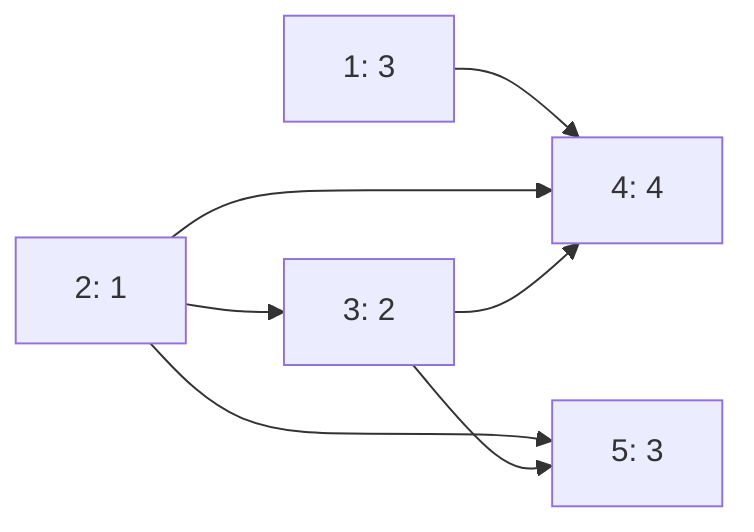
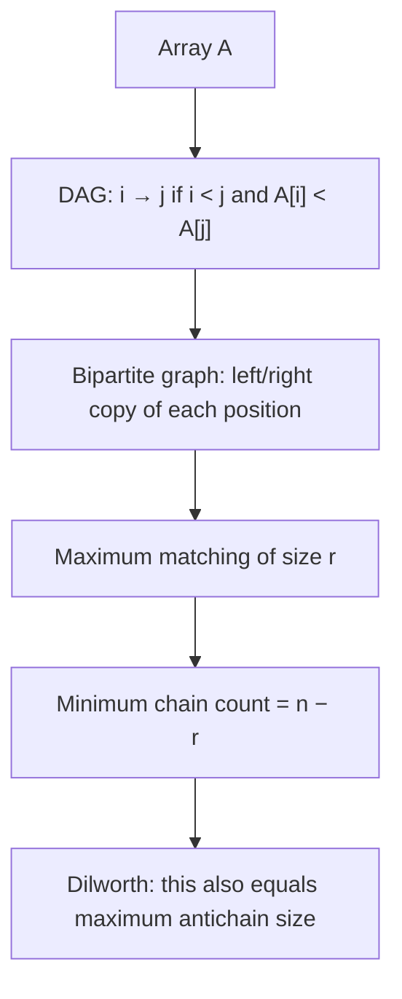

*How a problem about partitioning an array into increasing subsequences turns into a problem about finding a decreasing one.*

> **The puzzle:** Given an array `A`, partition its elements into the **fewest strictly increasing subsequences**. You may skip elements within a subsequence, but you must preserve their original order, and **every position must belong to exactly one subsequence**.

I came across this while studying flow networks in COMP3821. It looks like an LIS problem. It turns out that its answer comes from a rather surprising place: **antichains**, **partial orders**, and a theorem called **Dilworth's theorem**.

And the best part? We can compute the answer in **`O(n log n)`** time.

---

## 1. The obvious idea (that doesn't quite work)

If you've done dynamic programming, you've probably encountered the infamous [Longest Increasing Subsequence (LIS)](https://leetcode.com/problems/longest-increasing-subsequence/description/) problem.

Given an array, LIS asks for the longest subsequence whose values are **strictly increasing**. A classic `O(n²)` DP solution uses

$$
\operatorname{dp}[i]
=1+\max_{\substack{j<i\\A[j]<A[i]}}\operatorname{dp}[j],
$$

where the maximum over an empty set is treated as `0`.

```cpp
vector<int> dp(n, 1);
for (int i = 0; i < n; ++i) {
    for (int j = 0; j < i; ++j) {
        if (a[j] < a[i]) {
            dp[i] = max(dp[i], dp[j] + 1);
        }
    }
}
```

So here's a tempting strategy for our *partitioning* problem:

1. Find a longest increasing subsequence.
2. Remove its elements.
3. Repeat until nothing remains.

Surely taking the longest chain each time should minimise how many chains we need, right?

**Not necessarily.** Greedy choices can leave behind an awkward remainder.

<details>
<summary><strong>Reveal a counterexample (try finding one first!)</strong></summary>

Consider

```text
Index:   1  2  3  4  5  6
A:      [1, 2, 4, 1, 3, 4]
```

The **unique LIS** is `[1, 2, 3, 4]`, at positions `1, 2, 5, 6`.

If we remove it, the remaining values are `[4, 1]`. They cannot go into the same increasing subsequence, so our greedy approach uses **three** subsequences:

```text
Greedy:
  Chain 1: [1, 2, 3, 4]
  Chain 2: [4]
  Chain 3: [1]
```

But there's a partition into just **two**:

```text
Optimal:
  Chain 1: [1, 2, 4]     (positions 1, 2, 3)
  Chain 2: [1, 3, 4]     (positions 4, 5, 6)
```

Even taking a *unique* LIS first can be the wrong choice.

</details>

So instead of repeatedly asking **“What's the longest increasing chain I can take?”**, let's turn the question around.

**What's the largest collection of elements that *cannot* belong to the same increasing chain?**

That gives us something powerful: a **lower bound** on the number of chains we need.

---

## 2. The obstacle is the answer

Consider a different array:

$$
A=[5,2,4,1,3].
$$

Focus on the subsequence `[5, 4, 3]`, at positions `1, 3, 5`.

It is **decreasing**. No two of these three elements can lie in the same *strictly increasing* subsequence: whichever comes earlier has a larger value.

So **any** partition of the array needs at least three increasing subsequences.



And the diagram gives a partition into exactly **three** chains:

- `[5]`
- `[2, 4]`
- `[1, 3]`

That is, the lower bound is achievable.

Is that just a coincidence? **Dilworth's theorem says no.**

---

## 3. Meet chains, antichains, and posets

A **partially ordered set**, or **poset**, is a set equipped with a relation that is reflexive, antisymmetric, and transitive.

The important word is **partially**: unlike ordinary numerical order, two elements don't necessarily have to be comparable.

For our array, let's make the *positions* `1, 2, ..., n` the elements of a poset. Define

$$
i\preceq j
\quad\Longleftrightarrow\quad
\bigl(i=j\bigr)\ \text{or}\ \bigl(i<j\text{ and }A[i]<A[j]\bigr).
$$

That is, one position comes before another only if **both** the index and its value increase.

Why define it this way? Because it encodes the exact condition for two elements to appear in the same increasing subsequence.

### Chains

A **chain** is a set of pairwise comparable elements. In this poset, a chain is precisely a **strictly increasing subsequence**.

### Antichains

An **antichain** is a set of pairwise incomparable elements. If we list its positions in increasing order, the corresponding values must be **non-increasing**.

Why non-increasing rather than strictly decreasing? Because equal values are also incompatible with belonging to a *strictly* increasing subsequence.

| Concept in order theory | Meaning for an array |
|---|---|
| Chain | Strictly increasing subsequence |
| Antichain | Non-increasing subsequence |
| Minimum chain partition | Fewest increasing subsequences covering every position |
| Maximum antichain | Longest non-increasing subsequence |

Here's the partial order for the small array `[3, 1, 2, 4, 3]`. Each arrow means both index and value strictly increase; arrows for transitive comparisons are shown as well.



For example, positions `1` and `5` are *incomparable*: their values are both `3`, so they cannot be in the same strictly increasing chain.

---

## 4. The reveal: Dilworth's theorem

> **Dilworth's theorem.** In any finite poset, the **maximum number of pairwise incomparable elements** equals the **minimum number of chains required to partition the set**.

That is,

$$
\boxed{\text{maximum antichain size}=\text{minimum chain-partition size}}
$$

For our array, a chain is an increasing subsequence and an antichain is a non-increasing subsequence. So the theorem becomes:

$$
\boxed{
\begin{gathered}
\text{Minimum number of strictly increasing subsequences}\\
\text{in a partition of } A\\[3pt]
=\\[3pt]
\text{Length of a longest non-increasing subsequence.}
\end{gathered}
}
$$

Let's appreciate what just happened: **we solved a minimisation problem by finding a maximum of something that looks like its opposite.**

### Why this makes intuitive sense

The **easy half** is a counting argument. Suppose an antichain has `k` elements. No increasing chain can contain two of them, so any chain partition must have **at least `k` chains**.

The **surprising half** is Dilworth's guarantee: you can *always* partition the whole poset into exactly that many chains. No clever arrangement can force you to use more than the maximum antichain size.

For `[1, 2, 4, 1, 3, 4]`, a longest non-increasing subsequence has length `2` (for example, `[4, 1]`). Therefore, the minimum number of increasing subsequences is **exactly `2`** which agrees with our optimal partition from the counterexample.

> **A tiny gotcha:** If the array is `[7, 7, 7]`, you need **three** strictly increasing subsequences, not one. That's why the right dual is *longest non-increasing* subsequence, not *longest strictly decreasing* subsequence.

---

## 5. A fast algorithm in C++

Now we don't need to enumerate chain partitions at all. We just need the **length of the longest non-increasing subsequence (LNIS)**.

If you're familiar with the `O(n log n)` binary-search algorithm for LIS, this is almost the same thing.

One easy implementation trick: negate every number. A non-increasing subsequence of `A` becomes a **non-decreasing** subsequence of `-A`.

For *non-decreasing* subsequences, we use `upper_bound`, not `lower_bound`, so equal values may extend the subsequence.

```cpp
#include <algorithm>
#include <vector>
using namespace std;

int minIncreasingChains(const vector<int>& a) {
    vector<long long> tails;

    for (int x : a) {
        long long y = -static_cast<long long>(x);
        auto it = upper_bound(tails.begin(), tails.end(), y);

        if (it == tails.end()) {
            tails.push_back(y);
        } else {
            *it = y;
        }
    }

    return static_cast<int>(tails.size());
}
```

**Complexity:** `O(n log n)` time and `O(n)` auxiliary space. The `long long` conversion avoids overflow if the input contains `INT_MIN`.

The `tails` array is an algorithmic bookkeeping structure; it is **not** itself necessarily a longest subsequence.

### What if we want the actual chains?

The LNIS algorithm gives the **number** of chains. To construct an optimal partition, process the values from left to right and put each value `x` into a chain whose current last element is **the largest value strictly less than `x`**. If none exists, start a new chain.

We can maintain chain endings in an ordered set, giving another `O(n log n)` algorithm. This is a patience-sorting-style greedy algorithm for *constructing* the partition, and unlike repeatedly removing an LIS, it is optimal.

<details>
<summary><strong>C++ code to recover the actual partition</strong></summary>

```cpp
#include <limits>
#include <set>
#include <utility>
#include <vector>
using namespace std;

vector<vector<int>> partitionIntoIncreasingChains(const vector<int>& a) {
    vector<vector<int>> chains;
    // (last value in the chain, unique chain index)
    set<pair<int, int>> ends;

    for (int x : a) {
        auto it = ends.lower_bound({x, numeric_limits<int>::min()});

        if (it == ends.begin()) {
            int id = static_cast<int>(chains.size());
            chains.push_back({x});
            ends.insert({x, id});
        } else {
            --it;  // Largest ending value strictly smaller than x
            int id = it->second;
            ends.erase(it);
            chains[id].push_back(x);
            ends.insert({x, id});
        }
    }

    return chains;
}
```

Every element is appended after a smaller value, so each chain is strictly increasing. The best-fit rule produces the minimum number of chains; equivalently, the final count equals the LNIS length.

</details>

---

## 6. What does this have to do with flow networks?

This is where I originally encountered the idea.

Given a DAG, we can find a minimum **vertex-disjoint path cover** through bipartite matching. For our array poset, construct a DAG whose vertices are array positions, and add an edge `i → j` whenever `i < j` and `A[i] < A[j]`.

Every chain becomes a directed path in this DAG (we've included *all* comparable pairs, not just adjacent positions). So the minimum path cover is the minimum chain partition.



Why `n − r`? Initially, every vertex forms a one-vertex path. Each selected matching edge links two path pieces, reducing the number of paths by one. A maximum matching makes as many such links as possible, without allowing a vertex two predecessors or two successors. Because the original graph is acyclic, the chosen links cannot form cycles.

We can find that matching with a maximum-flow construction. It isn't the fastest method for arrays, but it's a **more general graph-algorithmic perspective**.

<details>
<summary><strong>Little more maths: why matching connects to antichains</strong></summary>

Create a bipartite graph with copies $i_L$ and $i_R$ of each position. Add $i_{L}$ $-$ $j_R$ whenever $i ≺ j$.

Let $r$ be the maximum matching size. As above, the minimum chain partition has size $n - r$

By **Kőnig's theorem**, there is a vertex cover of size $r$ in this bipartite graph. Take the original positions whose **neither copy** belongs to this cover. There are at least $n - r$ such positions.

They form an antichain: if $i < j$, the edge $i_{L}$ $-$ $j_R$ must be covered, so `i` and `j` cannot both have neither copy in the cover.

We therefore have an antichain of size at least `n − r`. But every antichain requires at least as many chains as its size, and the minimum chain partition has size `n − r`. Hence the maximum antichain size is exactly `n − r`.

That's a matching-based proof of Dilworth's theorem for this finite poset.

</details>

---

## 7. Try one yourself

Before opening the answer, consider:

```text
A = [4, 1, 3, 2]
```

**What's the minimum number of strictly increasing subsequences needed to partition this array?**

<details>
<summary><strong>Reveal the answer</strong></summary>

**Three.** The subsequence `[4, 3, 2]` is non-increasing and has length `3`, so at least three chains are necessary. One partition achieving three is `[4]`, `[1, 3]`, `[2]`.

</details>

---

## The takeaway

I initially thought of this as a problem about **building increasing subsequences**. Dilworth's theorem reframes it as a problem about **finding elements that cannot be grouped together**.

The same principle shows up well beyond arrays: scheduling, partially ordered tasks, DAG path covers, and matching problems.

> **Sometimes, to minimise the number of compatible groups, the best thing to study is the largest group of mutually incompatible elements.**

That's the beautiful part of Dilworth's theorem and why a theorem from order theory ended up being one of my favourite surprises from studying flow networks.
